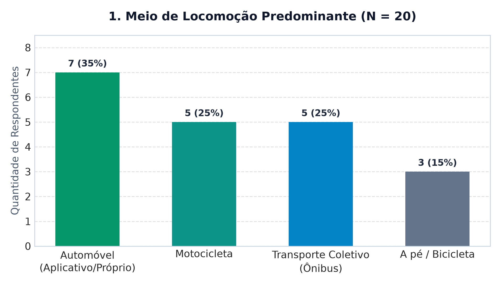
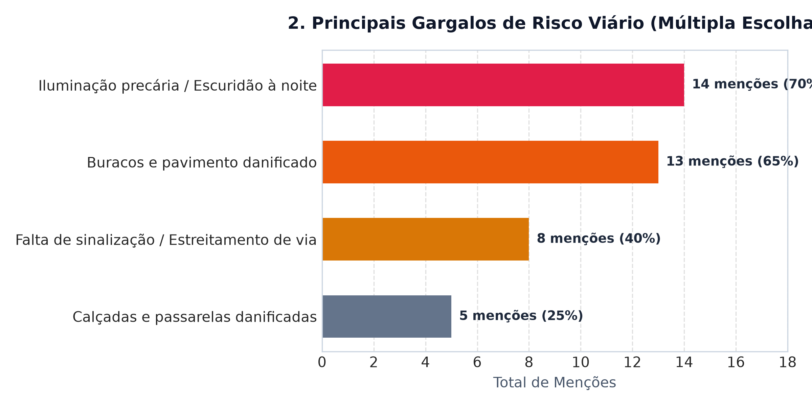
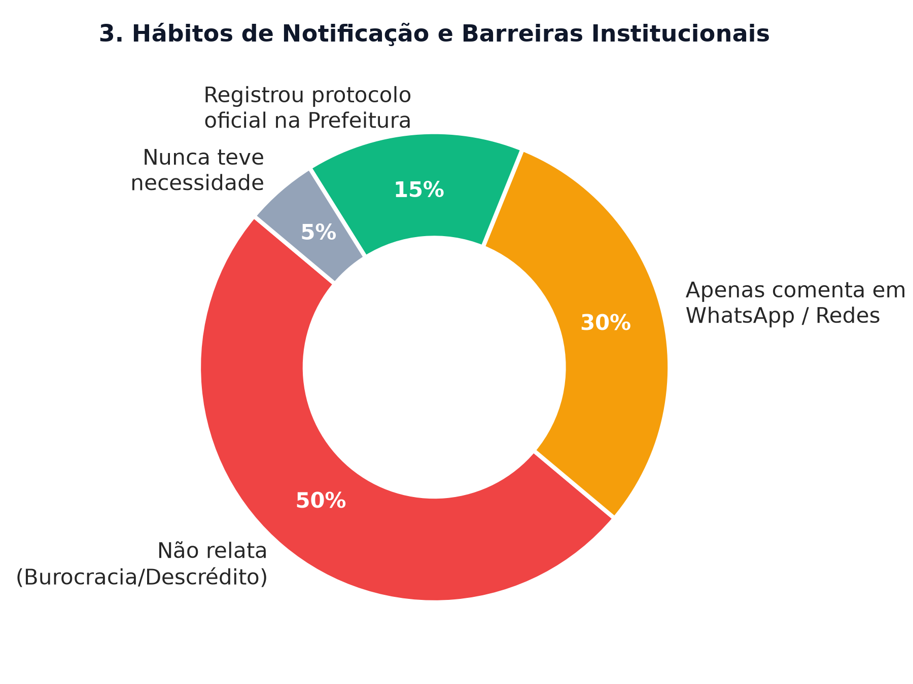
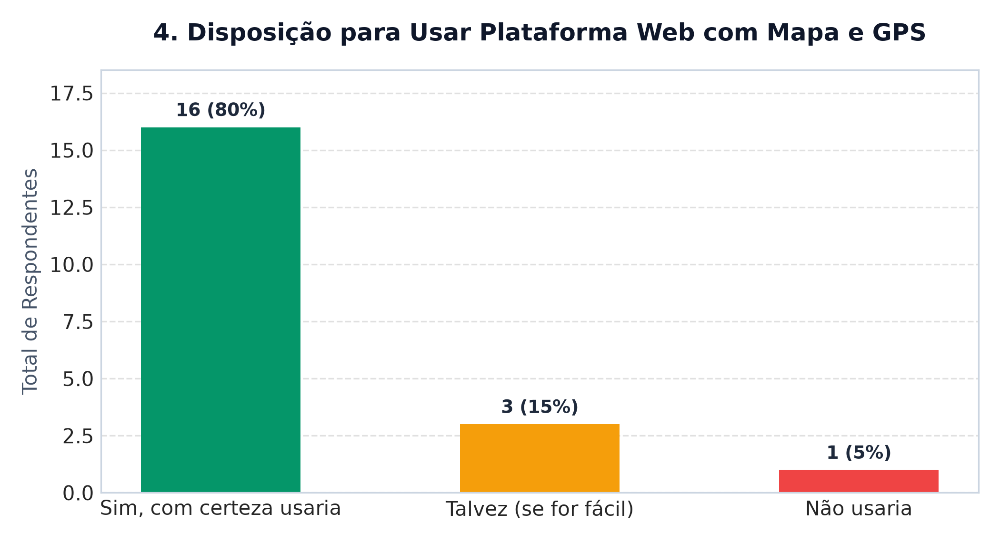

# Relatório Executivo: Pesquisa de Campo (ZelaJampa)

**Projeto de Extensão:** ZelaJampa | **Vínculo:** ODS 9 (Infraestrutura)  
**Recorte Territorial:** Intermares (Cabedelo) e Marginais da BR-230 | **Amostra:** N = 20 respondentes  

---

## 1. Perfil da Amostra e Mobilidade

Pesquisa realizada presencialmente com condutores, passageiros e pedestres. **70% circulam diariamente** pela região.

| Meio de Transporte | % | Perfil Predominante |
| :--- | :---: | :--- |
| **Automóvel (próprio/app)** | 35% | Condutores que enfrentam tráfego rápido nas marginais |
| **Motocicleta** | 25% | Grupo mais vulnerável a desníveis e brita solta |
| **Transporte Coletivo (ônibus)** | 25% | Usuários expostos à escuridão em paradas e passarelas |
| **A pé / Bicicleta** | 15% | Moradores que circulam pelas vias internas de Intermares |

---

## 2. Diagnóstico de Risco Viário

Cada respondente apontou até 2 problemas críticos no seu trajeto:

- **65% (13 menções):** Iluminação precária / Escuridão à noite
- **60% (12 menções):** Buracos e pavimento danificado
- **45% (9 menções):** Estreitamento de pista sem sinalização / placas
- **30% (6 menções):** Calçadas e passarelas deterioradas

> **Insight:** O perigo crítico reside na **sobreposição de fatores**: asfalto irregular e pistas afuniladas sem placas tornam-se armadilhas graves sob a falta de luz noturna.

---

## 3. Hábitos de Queixa e Barreiras Públicas

**80% dos entrevistados não utilizam canais oficiais da prefeitura**:

- **50%:** Desistem previamente por burocracia ou descrédito na agilidade pública.
- **30%:** Restringem-se a desabafar em grupos de WhatsApp e redes sociais.
- **15%:** Já registraram protocolo oficial junto aos órgãos municipais.
- **5%:** Nunca sentiram necessidade.

---

## 4. Validação da Plataforma ZelaJampa

Avaliação do interesse em utilizar página web rápida no celular (sem download ou senhas) para marcar falhas no mapa via GPS:

- **80% (16):** Usaria com certeza.
- **15% (3):** Talvez (se for simples e rápida).
- **5% (1):** Não usaria.

> **Taxa de aprovação: 95%**. O principal atrativo apontado foi a ausência de cadastros burocráticos e a visualização coletiva das queixas da vizinhança.

---

## 5. Trechos Críticos Identificados

1. **Marginais da BR-230 (polo comercial / Atacadão):** Asfalto cedendo e brita solta.
2. **Alças de retorno e acesso a Intermares:** Afunilamento brusco de via no escuro.
3. **Av. Mar Vermelho (Intermares):** Calçamento afundado e poças de lama persistentes.
4. **Paradas de ônibus da rodovia:** Pontos totalmente às escuras após as 18h.

---

## 6. Conclusões

1. **Demanda Confirmada:** A comunidade anseia por canal direto e desburocratizado de zeladoria.
2. **Solução Validada:** O agrupamento espacial por geohashing resolve a fragmentação das queixas.
3. **Próximo Passo:** Disponibilização da plataforma para lideranças locais e envio de relatórios de dados aos órgãos competentes.
